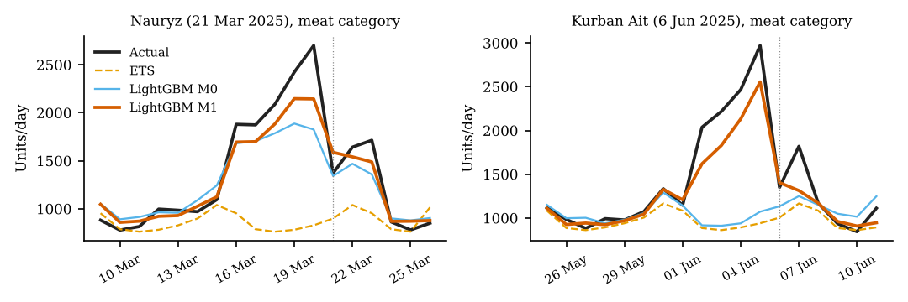

# QAZCAST — calendar-aware daily sales forecasting for Kazakhstani retail (prototype)

Simulation-based proof of concept (TRL 3–4) for the mini-R&D proposal *QAZCAST: Calendar-Aware Machine Learning
for Daily Sales Forecasting in Kazakhstani Retail* (CSS 410, SDU University).

**Key question:** can explicit local calendar features (Nauryz, Kurban Ait, long weekends) improve a global
LightGBM model, especially around *moving* holidays that yearly lags cannot capture?

## Results (20,160 test forecasts, Jan–Jun 2025)

| Model | WAPE all days | WAPE holiday window | WAPE Kurban Ait |
|---|---|---|---|
| Seasonal naive | 43.9% | 42.2% | 39.7% |
| ETS (baseline) | 28.8% | 31.6% | 34.5% |
| LightGBM M0 (no local calendar) | 26.8% | 27.4% | 32.4% |
| **QAZCAST M1 (with local calendar)** | **25.9%** | **26.1%** | **27.3%** |

Diebold–Mariano: M1 vs ETS p = 0.003, M1 vs M0 p = 0.029.



## Run

```bash
pip install -r requirements.txt
python demo.py         # instant: uses saved forecasts in out/, prints metrics and shows the Kurban Ait plot
python experiment.py   # full re-run (5–10 min): generates data, trains all models, rewrites out/
python figs.py         # rebuilds figures in figs/
```

## Data

Synthetic daily sales for 480 store–item series (6 categories, 4 stores, Jan 2022 – Jun 2025) built on the official
Kazakhstani holiday calendar, including the real dates of Kurban Ait. Holiday effect sizes are assumptions, so the
results show that the method can capture such patterns, not the size of real-world gains. Validation on real
point-of-sale data is the next step (WP1–WP2 of the proposal).

## Licence

MIT
